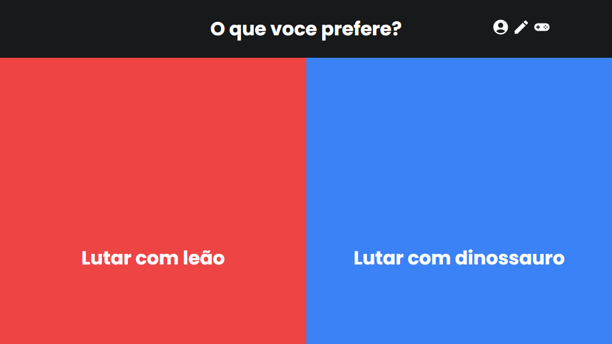
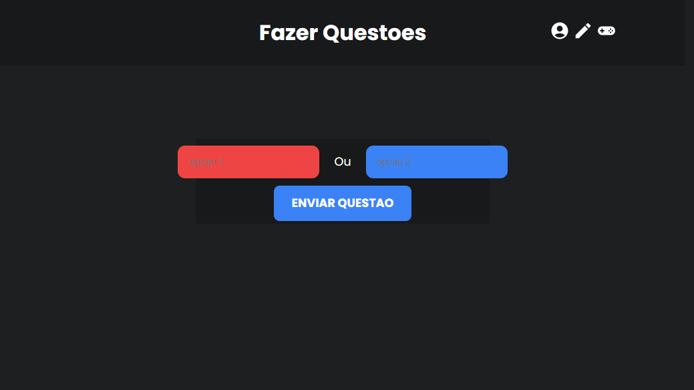

# Red or Blue

Um jogo de dilemas no estilo **"O que você prefere?"**. Escolha entre uma opção vermelha e uma azul e avance por uma coleção de 50 perguntas.

<p align="center">
	
	
</p>

## Funcionalidades

- 50 dilemas com duas alternativas para escolher.
- A seleção habilita o botão para avançar e indica a escolha pela cor.
- Navegação entre o jogo, a tela de login e o formulário para propor perguntas.

> [!NOTE]
> Login e envio de perguntas são telas demonstrativas no frontend. Ainda não há autenticação nem persistência de dados.

## Tecnologias

- React 19 e TypeScript
- Vite 8
- React Router e React Icons
- CSS e ESLint

## Executar localmente

Requisitos: Node.js compatível com Vite 8 (20.19+ ou 22.12+) e npm.

```bash
git clone https://github.com/iamT0ddykk/Red-or-Blue.git
cd Red-or-Blue
npm install
npm run dev
```

Abra o endereço local exibido pelo Vite, geralmente `http://localhost:5173`.

## Scripts

| Comando           | Descrição                                                 |
| ----------------- | --------------------------------------------------------- |
| `npm run dev`     | Inicia o servidor de desenvolvimento.                     |
| `npm run build`   | Verifica os tipos e gera a versão de produção em `dist/`. |
| `npm run preview` | Serve localmente a versão de produção.                    |
| `npm run lint`    | Executa o ESLint.                                         |

## Estrutura

```text
src/
├── App.tsx                  # Fluxo principal do jogo
├── opcao.ts                 # Dilemas e alternativas
├── components/              # Cabeçalho, alternativas e botão
├── pages/                   # Telas de login e criação de perguntas
└── styles/                  # Estilos globais e do jogo
public/
└── readme-*.png             # Capturas usadas neste README
```
